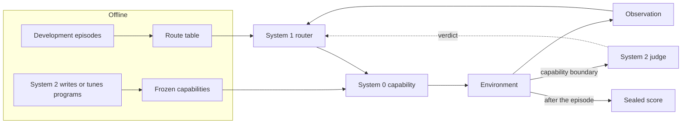

# Architecture

REA (Routed Embodied Agent) separates what acts from what chooses and what thinks:

| Layer | Role | Examples in this repository |
|---|---|---|
| **System 0**: capabilities | Produce actions at control rate. Never wait for a model call they did not make themselves. | Frozen code programs, VLA servers (pi0.5, LingBot-VLA, RoboTwin VLAs), LLM tool-calling controllers, scripted and motion controllers, the G1 cerebellum |
| **System 1**: router | Picks the capability for the next interval and decides when to switch. Cheap and local. | Route memory with a boundary judge gate and an escalation ladder; advice-following routers; the RoboTwin success router |
| **System 2**: brain | Deliberates. Writes or selects capabilities offline; online it only judges or advises at boundaries. | A VLM completion judge, a chat model that recommends a controller, program-writing agents |

The rule that ties them together: **no running capability waits for the brain.** System 2 is consulted at boundaries
(between capability runs, or in the background while a capability runs), and its answers take effect at the next boundary.

## Two runtimes

Both runtimes use the same environments, System 0 policies, budgets, recordings and reports. Select one with
`systems.mode` in a configuration.

**Routed** (`mode: "routed"`, [routed systems](routed-systems.md)). REA's episode:

1. route memory picks the first capability for the task from development evidence;
2. the capability runs until it returns, fails, or uses its step allowance;
3. at that boundary System 1 decides whether to stop or escalate to the next rung of a fixed ladder, optionally after
   asking System 2 to judge completion from the current images;
4. all runs share one step and wall budget;
5. success is read once, after the episode (`environment.score()`), never on the control path.

**Asynchronous** (`mode: "async"` or `"sync"`, [asynchronous systems](async-systems.md)). System 1 routes at every action
boundary while System 2 thinks in the background and publishes advice that applies at a later boundary. `sync` waits for
each scheduled thought and is the comparison arm.

A plain `policy` configuration (no `systems`) runs a single System 0 policy with `runEpisode`.



## Contracts

Every extension is a small object. The full field lists are in the [framework reference](framework.md).

| Contract | Shape | Guide |
|---|---|---|
| Environment | `reset({task, seed, signal})`, `step(action, context)` → transition; optional `observe`, `stop`, `close`, `score`, `scorecard`, `resumable` | [Environments and benchmarks](extending/environments.md) |
| System 0 policy | `decide(input)` → `{action, thought?, notes?, usage?, model?}`; optional `reset`, `close` | [Policies](extending/policies.md) |
| System 1 router | `route(input)` → `{candidateId, reason}` (routed mode may return `{stop: true}`) | [Routers and brains](extending/systems.md) |
| System 2 | `judge(input)` → `{verdict}` in routed mode; `think(input)` → `{candidateId?, directive?}` in async mode | [Routers and brains](extending/systems.md) |
| Robot driver | `describe`, `reset`, `observe`, `step(action, {execute})`, `stop`, `close` (JavaScript or Python) | [Real robots](extending/robots.md) |
| Program backend | JSON-lines: `catalog`, `reset`, `run_program` / `program_chunk`, `observe`, `score`, `close` | [Program backends](extending/program-backends.md) |
| Policy server | `rea serve`, for platforms that run their own loop: JSON-lines `configure`, `reset`, `step`, `end`, `close`; Python client and XPolicyLab adapter | [Policy server](extending/policy-server.md) |

Extensions are registered on a `createRegistry()` instance or loaded from a configuration with `type: "module"`; no file
in `src/` needs to change. A platform that runs its own control loop calls REA instead: `rea serve` runs any of the
runtimes above on a bridge environment whose observations come from the platform.

## Repository layout

```text
src/framework/      runtimes (runEpisode, runAsyncEpisode, runRoutedEpisode), route memory, judge gate,
                    configuration, registry, evaluation, CLI doctor
src/environments/   environment adapters: LIBERO, ARC-AGI-3, Gymnasium, ALOHA, LeRobot, OpenRAL, RPent, G1,
                    generic robot and Python-driver wrappers
src/policies/       System 0 policies: pi0.5, LingBot-VLA, RoboTwin VLA and code policies, ALOHA code policy,
                    success router
src/                the G1 service (server.mjs, thinker.mjs): engines, gate, executor, brain, memory
scripts/            the `rea` CLI, Python backends (LIBERO, LIBERO programs, ASPIRE, BEHAVIOR, ARC-AGI-3,
                    Gymnasium, robot drivers), VLA clients, code workers, G1 robot-side workers
eval/               benchmark integrations: BEHAVIOR runner and online agent, RoboTwin VLA/code runner,
                    G1 service evaluation utilities
tools/              route-table builder, program-bundle builder, self-hosted judge server
integrations/       clients and adapters for platforms that call REA as a policy: Python client, XPolicyLab (RoboDojo)
agent-vla-async/    the G1 cerebellum (Python): VLA/controller runtime behind the `cerebellum` actuator
examples/           runnable configurations, offline demos and robot configuration templates
test/               Node and Python tests; everything runs offline
```
