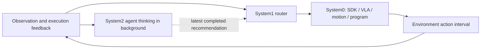

# Asynchronous systems: System 1 routes while System 2 thinks

For REA's routed episodes (route memory, a judge gate at capability boundaries, an escalation ladder and a sealed
score), see [routed systems](routed-systems.md); this page covers per-action routing with background thinking.

System0 is the capability that acts: an SDK controller, VLA policy, motion model,
or program. System1 chooses that capability at each action boundary. System2
reasons over observations and execution feedback, then publishes a recommendation
that System1 can apply at a later boundary.



An unfinished System2 request does not hold the next route or action. One thinking
request runs at a time; the next request receives the newest scheduled observation,
instead of accumulating a backlog. Completed advice has a source step and a bounded
age. Applying advice and merely completing a thought are different recorded events.
The router can also choose a different controller based on immediate feedback while
the brain is busy.

For execution priority, set `thinkingSchedule: "after_dispatch"` in `systems`.
In async mode, this calls System0 and dispatches its environment action before
starting a scheduled System2 request. Busy thinking slots are skipped, with no
queued restart when a request finishes. The next eligible action supplies fresh
input. `thinkEverySteps` controls the spacing; explicit evidence-loop requests
also wait for the next dispatch. The default `"before_route"` schedule retains
the latest-input queue described above. Sync mode always waits for scheduled
thinking before routing, regardless of this setting.

Actions on one environment remain ordered. A capability must expose a meaningful
action interval: a VLA action chunk, an SDK motion interval, or a resumable program
segment. Rerouting happens at these boundaries. A blocking, whole-task SDK call gives
the router only one boundary when it returns. This runtime does not preempt an
arbitrary driver in the middle of its control call.

The LIBERO program adapter preserves the Python stack in a `greenlet`, yielding
after a configured number of real simulator control steps. Continuing a candidate
resumes the same stack. Switching abandons it and starts the selected frozen
program from the current physical state. Stopping this adapter takes effect when
the active chunk returns; it does not forcibly interrupt a blocking SDK primitive.
Its optional Python dependency is listed in `requirements-async-libero.txt`.

## Try the complete loop

```bash
npm run demo:async -- --events
npm run demo:async -- --sync --events
npm run console:async
```

The console prints its local URL. It shows three concurrent lanes, the scene,
route changes, submitted/completed/applied advice, and measured overlap. The
deterministic demonstration contains three synthetic controllers labelled SDK,
VLA and motion to illustrate scheduling; it does not run a learned VLA model.

The same demonstration works through the existing framework entry point:

```bash
npm run rea -- run examples/async-system.config.mjs --events --output outputs/async-demo
npm run console:async -- --replay outputs/async-demo/0001.events.jsonl
```

`evaluate()` writes the usual episode transitions and results plus
`0001.events.jsonl` for each systems episode. The console can replay these events
or tail the same file while an episode runs.

## Start, subscribe, cancel

```js
import { createEmbodiedAgent } from "rea-agent";   // inside this repository: ./src/framework/index.mjs

const agent = await createEmbodiedAgent("./examples/async-system.config.mjs");
const session = agent.start();
const unsubscribe = session.subscribe(event => console.log(event));
console.log(session.id, session.status());
// session.cancel("operator stopped the run");
const result = await session.done;
unsubscribe();
await agent.close();
```

`start()` returns a handle immediately. `history({after})` and
`subscribe(listener, {after, replay})` support reconnecting to an existing session.
`run()` remains available when only the final result is needed. One agent owns one
active environment run; create separate agents for independent environments.

## Configure your own systems

```js
const config = {
  environment: { type: "module", options: { module: "./robot.mjs" } },
  systems: {
    mode: "async",
    system0: [
      { id: "sdk", kind: "sdk", policy: { type: "module", options: { module: "./sdk-controller.mjs" } } },
      { id: "vla", kind: "vla", policy: { type: "module", options: { module: "./vla-controller.mjs" } } },
    ],
    system1: { type: "module", options: { module: "./router.mjs" } },
    system2: { type: "chat", options: { model: "your-model", baseUrl: "your-endpoint" } },
    thinkEverySteps: 2,
    maxAdviceAgeSteps: 12,
    thinkingTimeoutMs: 60000,
  },
  episodes: [{ task: "Pick up the cup", seed: 1 }],
  budget: { maxSteps: 100, maxDurationMs: 300000 },
};
```

System0 policies use the existing `decide(input) -> {action, ...}` contract.
The built-in [`lingbot-vla` policy](policies/lingbot-vla.md) connects LingBot-VLA 2.0's
official WebSocket server with configurable camera/state mappings and action
chunks. It performs fresh inference at each selected boundary and discards the
unused tail, so switching away and back cannot replay an old prediction.
`examples/lingbot-vla-async.config.mjs` runs it as a System0 candidate on RPent
RoboTwin.
System1 modules export a factory returning a function or an object with `route`:

```js
export default () => ({
  route({ advice, previousCandidateId, feedback, thinking }) {
    return {
      candidateId: advice?.candidateId ?? previousCandidateId ?? "sdk",
      reason: advice?.reason ?? "Continue the available controller",
      usedAdvice: Boolean(advice),
    };
  },
});
```

Omitting System1 uses this latest-advice/previous-controller routing rule.
`minControllerSteps` (default `1`) makes the built-in selector keep the current
controller until it has completed that many consecutive action blocks. Blocked
commands do not count. Different-candidate advice is deferred, still subject to
the normal age limit. Transitions record `route.deferredCandidateId` when a switch
is postponed. Custom System1 routers own their switching rules.
The ALOHA configurations use execution priority with four-block thinking and
switching intervals by default. A custom router can consider current feedback or
run its own inference. System2 modules
export a factory returning `{think(input), reset?, close?}`. `think` returns
`{candidateId?, directive?, reason?, usage?, model?}` and receives an `AbortSignal`.
An existing agent or SDK can be wrapped in this contract. The chat adapter uses
the existing model transport and carries observations, images, candidate
descriptions and recent transitions to the brain.

System1 sees `{observation, actions, history, notes, feedback, instruction, budget,
step, candidates, advice, thinking, previousCandidateId, signal}`. System0 receives
the selected route and the directive acknowledged by System1. The runtime also
appends that directive to the action's instruction while preserving the original
task, so existing chat controllers receive it. Selecting the
recommended controller acknowledges advice automatically; a router using only the
directive can return `usedAdvice: true`. A System0 policy that actually changes its
action using a directive can return `usedAdvice: true` in its decision. This makes
same-controller corrections distinguishable from merely forwarding a directive.

For programmatic integration, `runAsyncEpisode()` takes the instantiated
`environment`, `system0`, `system1`, `system2` and the same budgets directly.
The caller owns resource `close()`; the runner resets episode state and stops
the environment at completion. `createEmbodiedAgent` manages resource closure.

`loop: true` in `systems` (or in `runAsyncEpisode()`) applies the routed policy's
experimental [evidence loop](framework.md#evidence-loop-experimental-opt-in) at
the System0 action boundary. The gate screens each dispatched command; a blocked
command consumes one decision without moving the robot and is recorded with
`info.gate.allowed: false`. Completion claims go to the rule judge. A
`not_complete` verdict queues a recovery macro that runs as the `loop:recover`
capability, and uncertain or exhausted cases start a System2 request immediately
with the evidence as `guidance`. Transitions carry the `nodes` trace and, as in
`runEpisode`, any `claim` and progress `review` returned by System0. The loop is
off by default.

## Events and measurements

Events contain `type`, `status`, `atMs`, `timestampMs`, `step` and the relevant
request ID. Thinking events identify the observation's `sourceStep`; action and
routing events identify the selected `candidateId`. Sessions add `sessionId` and
an increasing `sequence` for replay/SSE reconnection.

| Metric | Meaning |
| --- | --- |
| `resetMs` | Episode entry to completed environment reset |
| `firstActionMs` | Episode entry to first action dispatch, including reset |
| `firstActionAfterResetMs` | Completed reset to first dispatch; separates control startup from simulator initialization |
| `overlapMs` | Measured intersection of System2 request intervals and environment action intervals |
| `blockedThinkingMs` | Time the control path waited for System2 in sync mode |
| `routedWhileThinking` | Routes started while a System2 request was active |
| `routeChanges` | Changes of selected System0 controller |
| `adviceApplied` / `corrections` | Advice acknowledged at dispatch / advised controller changes or policy-confirmed directive use on later actions |
| `system0Calls`, `system1Calls`, `system2Calls` | Calls per role; token usage reported separately |

`decisionCalls` counts calls to configured controllers, routers and brains, which
may be deterministic programs or models. It is not an LLM request count. Token
usage is reported in `usageBySystem`, including usage attached to failed responses;
`usageCompleteBySystem` states whether every call for that role supplied usage
(`null` for an unconfigured role). The built-in routing rule is counted in
`system1Calls` but does not add a configured `decisionCalls` invocation.

`mode: "sync"` uses the same controllers, brain and routing contract but waits at
each scheduled thinking point. This is the comparison arm. Async mode may execute
additional actions before advice arrives and may coalesce observations into fewer
brain calls. Compare success, action count and model usage alongside wall time.
